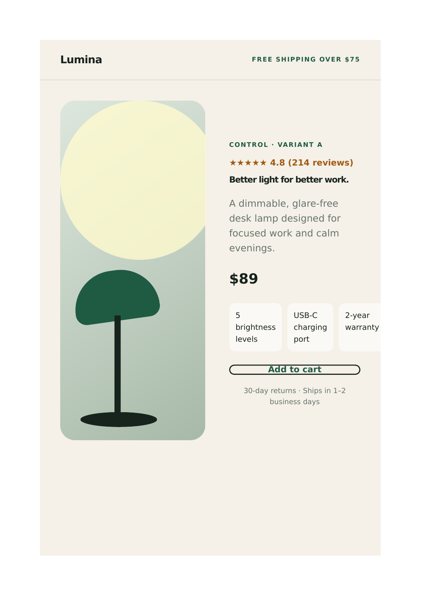

# E-commerce A/B Testing Case Study

An end-to-end experimentation prototype for **Lumina**, a fictional e-commerce brand. The project connects a controlled product-page change to an explicit hypothesis, event instrumentation, a pre-specified statistical method, and a decision framework.

> **Experiment status:** Design and implementation complete; no live experiment has been run. This repository contains no claimed or fabricated results.

## Business question

Can a higher-contrast purchase button with price information increase product-page purchase intent without harming the customer experience?

**Hypothesis:** Visitors shown Variant B will click the purchase CTA at a higher rate than visitors shown Variant A because the CTA is more visually prominent and confirms the price at the decision point.

Only the CTA treatment changes. Product, price, copy, benefits, reviews, layout, and reassurance text remain constant, reducing ambiguity about what caused any observed difference.

## The variants

| Control — Variant A | Treatment — Variant B |
|---|---|
| Outline button: “Add to cart” | High-contrast button: “Add to cart — $89” |
|  |  |

Open the source: [`src/variant-a/index.html`](src/variant-a/index.html) and [`src/variant-b/index.html`](src/variant-b/index.html).

## Experiment design

- **Unit of randomization:** unique visitor.
- **Allocation:** 50/50, assigned server-side and persisted for the experiment duration.
- **Population:** eligible product-detail-page visitors; exclude employees, bots, duplicate events, and QA traffic.
- **Primary metric:** purchase CTA click-through rate = unique visitors with `purchase_click` / unique visitors with `product_view`.
- **Business outcome:** completed purchase conversion should be added when a checkout backend exists. CTA clicks are an intent proxy, not revenue.
- **Guardrails:** page error rate, checkout completion among CTA clickers, refund/cancellation rate, and page performance. These require production systems and are not measured by this static prototype.

The browser demo records `product_view` and `purchase_click` events in `localStorage` for instrumentation review. It is not a production analytics pipeline.

## Statistical approach

The analysis plan is fixed before observing results:

1. Use a two-sided two-proportion z-test to compare visitor-level conversion rates.
2. Use `alpha = 0.05` and target `80%` power.
3. Report conversion rates, absolute and relative lift, p-value, and a 95% confidence interval for the absolute difference.
4. Size the test from a historical baseline and a business-approved minimum detectable effect (MDE). Do not choose these values after seeing the data.
5. Run for at least one full business cycle and until the precomputed sample size is reached. Do not repeatedly stop when significance first appears.

The script includes `sample_size_per_variant(baseline, mde)`. For a real launch, the team must supply the historical baseline, practical MDE, expected traffic, seasonality constraints, and guardrail thresholds. No made-up inputs are presented as business facts here.

## Decision framework

Ship Variant B only if the experiment reaches its planned sample size, the primary metric's improvement is both statistically significant and practically meaningful, and no guardrail shows material harm. Otherwise retain Variant A, document the result, and use the confidence interval to decide whether to iterate or conclude the tested change is not worthwhile.

## Reproduce locally

```bash
git clone https://github.com/OugoMartin/Building-a-Web-App-with-A-B-Testing.git
cd Building-a-Web-App-with-A-B-Testing
python -m http.server 8000
```

Visit `http://localhost:8000`, then choose either variant.

To analyze real aggregate observations:

```bash
python -m venv .venv
source .venv/bin/activate        # Windows: .venv\Scripts\activate
pip install -r requirements.txt
cp analysis/input_template.csv analysis/observations.csv
# Fill observations.csv with actual visitor and purchase counts.
python analysis/analyze_experiment.py analysis/observations.csv
python -m unittest discover -s tests
```

## Repository structure

```text
.
├── analysis/                 # Input contract and statistical analysis
├── docs/screenshots/         # README-visible variant previews
├── src/shared/               # Shared styling and event instrumentation
├── src/variant-a/            # Control experience
├── src/variant-b/            # Treatment experience
├── tests/                    # Analysis checks
├── index.html                # Variant preview hub
└── requirements.txt          # Pinned analysis dependencies
```

## Assumptions and limitations

- The storefront and brand are fictional; the pages demonstrate implementation and experimentation skills.
- No randomization service, identity layer, checkout, or analytics warehouse is included.
- `localStorage` is suitable for a demo only. Production events should be validated server-side, deduplicated by visitor and experiment exposure, and monitored for sample-ratio mismatch.
- The analysis expects one aggregate row per variant. A production review should also check assignment integrity, missing data, novelty effects, and heterogeneous effects defined before launch.

## Production instrumentation

At assignment, emit an immutable exposure event with `experiment_id`, `variant`, `visitor_id`, and timestamp. Join exposure to validated purchase events in the analytics warehouse, count each eligible visitor once, and run automated QA for event volume, duplicate IDs, and a 50/50 sample-ratio mismatch before interpreting outcomes.

## Results

**Not available.** No live traffic or verified purchase data has been collected. The repository intentionally stops at a reproducible analysis plan instead of presenting simulated observations as experimental evidence.
